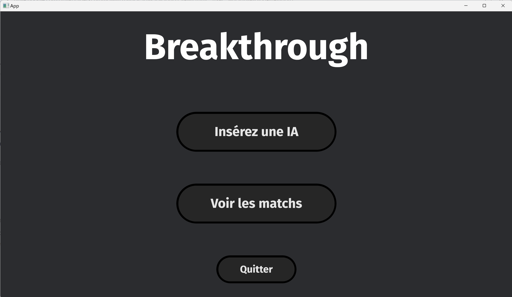
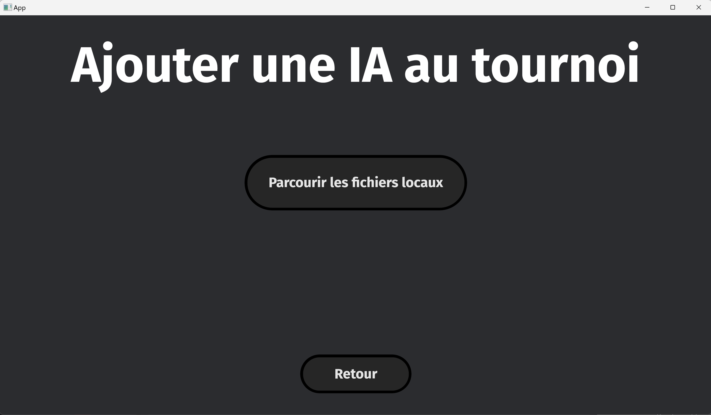
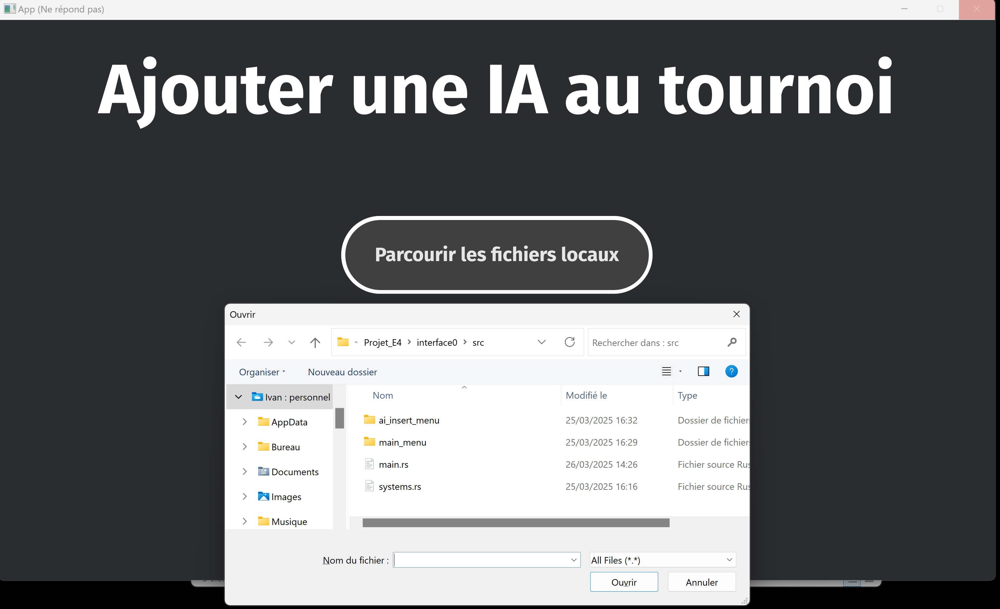

# PROJET E4 RUST

Version 1.0 

Plateforme de compétition de programmes écrit avec le langage Rust appliqué à l'Intelligence Artifficielle pour le jeu BreakThrough.

## Installation
1. Télécharger et décompresser l'archive <span style="color:rgb(38, 87, 178)">PROJET_E4_RUST.zip</span>.

> Assurez vous d'avoir dans votre répertoire <span style="color:rgb(78, 178, 38)">PROJET_E4_RUST</span> les fichiers et dossiers suivant :
>
>```
> 📦PROJET_E4_RUST
>┣ 📂.git
>┣ 📂src
>┣ 📜.gitignore
>┣ 📜Cargo.lock
>┣ 📜Cargo.toml
>┣ 📜LICENSE
>┗ 📜README.md
>```
> Note : <span style="color:rgb(78, 178, 38)">📂.git</span> est un dossier caché, si vous n'avez pas activé l'option "afficher les éléments masqués" ce dossier n'apparaîtra pas.


## Usage

Ouvrez un <span style="color:rgb(38, 87, 178)">Terminal</span> de commande et assurez vous de vous placer dans le répertoire PROJET_E4_RUST. 

> Dans votre terminal si vous entrez les commandes suivantes vous devriez obtenir un affichage similaire :
>
>Linux :
>```bash
> $ ls
>Cargo.lock Cargo.toml LICENSE README.md src/
>```

<div style="page-break-after: always;"></div>

>Windows :
>```powershell
> PS C:\Chemin_vers_votre_dossier\PROJET_E4_RUST> dir
>
>Répertoire : C:\Chemin_vers_votre_dossier\PROJET_E4_RUST
>
>
>Mode                 LastWriteTime         Length Name
>----                 -------------         ------ ----
>d-----        24/03/2025     02:07                src
>-a----        20/03/2025     01:27            817 .gitignore
>-a----        24/03/2025     03:29          12524 Cargo.lock
>-a----        24/03/2025     03:14            250 Cargo.toml
>-a----        20/03/2025     01:27          35823 LICENSE
>-a----        24/03/2025     20:12            171 README.md
>```

Ensuite, compilez le projet à l'aide de la commande suivante :

```bash
$ cargo b --release
```

Enfin pour exécuter le programme entrez la commande suivante :

```bash
$ cargo r
```

Pour accéder à la documentation du projet vous pouvez utiliser la commande suivante : 

```bash
$ cargo doc --open
```

*Cette commande génère la documentation si elle n'a pas été générée, l'option <span style="color:rgb(152, 178, 38)">--open</span> permet d'ouvrir la page html correspondant à la documentation.*

> Note : Les commandes sont les mêmes peut importe la plateforme (Windows, Linux, MacOS). 

## Features

- Système de création de tournois 
    - Ajout d'IA à un tournoi en écrivant le code directement dans le terminal.
    - Possibilité d'afficher les participants
    - Système de score et Tableau des scores.
- Historique des parties.
    - Replay des parties.
    - Enregistrement des parties.
- Interface Terminale Interactive (Vous pouvez avoir un aperçu [ici](#aperçu))

<div style="page-break-after: always;"></div>

## Aperçu 

### Interface Terminale

Interface principal :

```bash
🎮 Bienvenue sur le gestionnaire de tournoi 🎮
1️⃣  Créer un tournoi
2️⃣  Quitter
👉 Saisissez votre choix: 
```

Interface de gestion de tournois :

```bash
🏆 Menu du tournoi: tournois_ESIEE 🏆
📌 Status: ⏳ En Attente
1️⃣  Ajouter une IA
2️⃣  Afficher les participants
3️⃣  Démarrer le tournoi
4️⃣  Afficher le tableau des scores
5️⃣  Jouer le tournoi
6️⃣  Rejouer une partie
7️⃣  Mettre fin au tournoi
```

Exemple d'affichage des participants :

```bash
🤖 Participants du tournoi:
1. ia_test
2. ai_random4
3. ai_random3
4. ai_random2
5. ai_random
🔄 Appuyez sur entrée pour continuer...
```

Exemple de tableau des scores :

```bash
🏆 Résultats du Tournoi 🏆
1. ai_random4 - 3 points
2. ai_random - 3 points
3. ia_test - 2 points
4. ai_random2 - 1 points
5. ai_random3 - 1 points
🔄 Appuyez sur entrée pour continuer...
```

<div style="page-break-after: always;"></div>

Exemple sélection d'un replay :

```bash
🎮 Choisissez une partie à regarder:
1: ai_random2_vs_ai_random.txt
2: ai_random3_vs_ai_random.txt
3: ai_random3_vs_ai_random2.txt
4: ai_random4_vs_ai_random.txt
5: ai_random4_vs_ai_random2.txt
6: ai_random4_vs_ai_random3.txt
7: ia_test_vs_ai_random.txt
8: ia_test_vs_ai_random2.txt
9: ia_test_vs_ai_random3.txt
10: ia_test_vs_ai_random4.txt
👉 Saisissez votre choix:
```

<div style="page-break-after: always;"></div>

### Interface Graphique

Interface graphique développée avec la bibliothèque Bevy.

>Menu Principal :
>
 >.


>Menu d'ajout d'IA :
>
 >.

<div style="page-break-after: always;"></div>

 > Ajouter une IA via un fichier :
>
 >.
